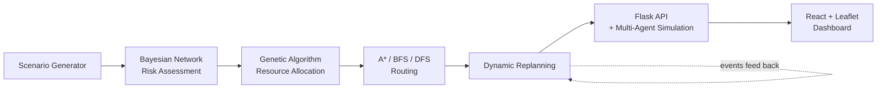
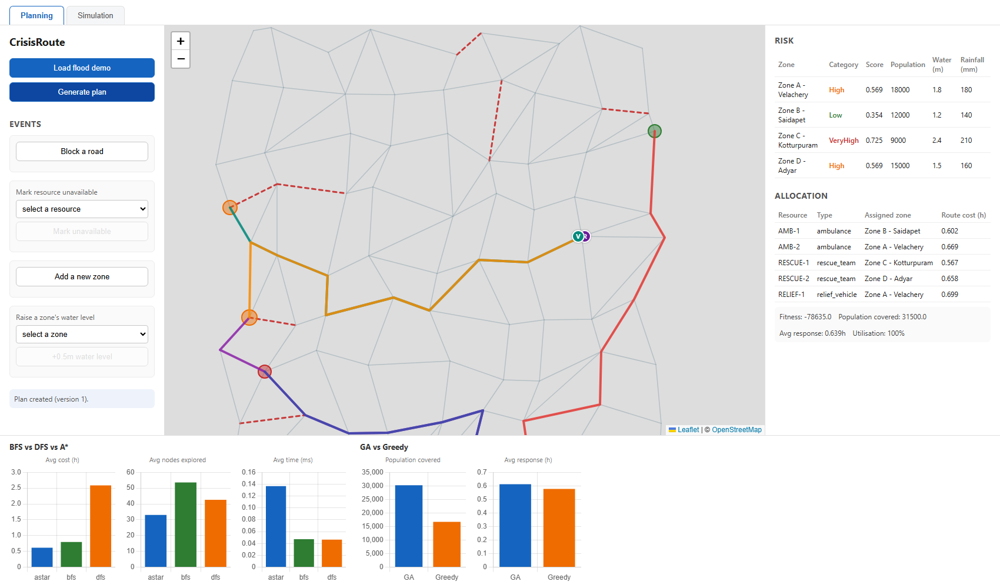
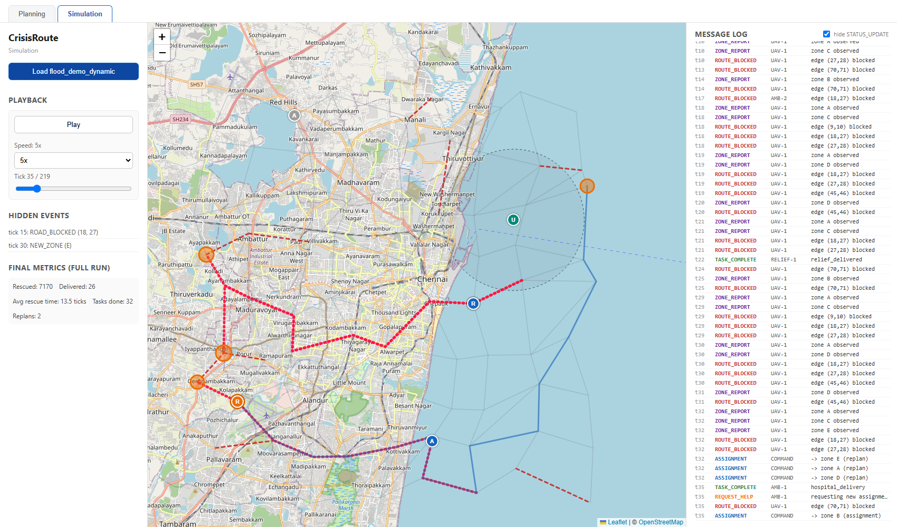

# CrisisRoute

CrisisRoute is an academic AI decision-support system for disaster response.
Given a synthetic crisis scenario — a road network, hazard zones, population
centers, and a limited pool of ambulances, rescue teams, and relief vehicles —
it assesses risk with a Bayesian Network, allocates resources with a
hand-written Genetic Algorithm, routes them with hand-written A*/BFS/DFS
search, and replans automatically as conditions change (a road is blocked, a
new zone appears, a resource becomes unavailable). A discrete-time multi-agent
simulation layer runs the plan forward tick by tick with partial
observability, and a React + Leaflet dashboard visualizes all of it live.

## Key features

- **Synthetic scenario generator** — reproducible, seeded road networks,
  hazard zones, resources, and hospitals (jittered grid around Chennai).
- **Bayesian Network risk assessment** (pgmpy) — explicit, hand-specified
  CPTs over hazard severity, population, and infrastructure condition.
- **Genetic Algorithm resource allocation**, hand-written (no DEAP), with a
  greedy baseline for comparison.
- **A*/BFS/DFS routing**, hand-written (no networkx), verified optimal
  against a brute-force Dijkstra oracle in tests.
- **Dynamic replanning** — reroutes or reruns the GA in response to road
  blockages, new zones, resource loss, and risk changes, choosing the
  cheaper option automatically.
- **Multi-agent simulation** — five agent types (ambulance, rescue team,
  supply vehicle, UAV, command center) coordinating only through a typed
  message bus, with hidden events the command center must discover before
  it can react.
- **Flask + SQLite API** and a **React + Leaflet + Chart.js dashboard** with
  separate Planning and Simulation tabs.
- **Evaluation suite** — 30-seed sweeps comparing routing algorithms, GA vs.
  greedy allocation, and static vs. dynamic replanning, at two scenario
  scales.

## Architecture



## Tech stack

| Layer | Technology |
|---|---|
| Backend language | Python 3.13 |
| Web API | Flask, Flask-CORS |
| Persistence | SQLAlchemy, SQLite |
| Risk model | pgmpy (Bayesian Network, exact inference) |
| Allocation / routing | NumPy, hand-written GA and A*/BFS/DFS |
| Evaluation | Matplotlib, pytest |
| Frontend | React, Vite |
| Map / charts | react-leaflet (Leaflet), Chart.js (react-chartjs-2) |

## Folder structure

```
backend/crisisroute/
  scenario/      synthetic scenario generator
  risk/          Bayesian Network risk assessment
  allocation/    GA resource allocation + greedy baseline
  routing/       A*, BFS, DFS
  replanning/    dynamic replanning
  agents/        multi-agent simulation (message bus, agents, world)
  api/           Flask API + SQLite
backend/tests/   pytest tests, mirroring the above modules
frontend/        React + Leaflet + Chart.js dashboard
eval/            evaluation script, results (CSVs), figures (PNGs)
docs/            project spec, implementation report, screenshots
```

## Setup and run (Windows)

### Backend

```bash
cd backend
python -m venv venv
venv\Scripts\pip install -r requirements.txt
```

### Frontend

```bash
cd frontend
npm install
```

### Run both services together

```powershell
# From the repository root:
.\start.ps1
```

This starts the Flask API on `http://localhost:5000` and the Vite dev server
on `http://localhost:5173`, each in its own window, waiting until both are up.
Equivalently, run `python run_api.py` in `backend/` and `npm run dev` in
`frontend/` in two separate terminals.

## Tests and evaluation

```bash
cd backend && venv\Scripts\pytest tests -q      # 239 tests
cd eval && ..\backend\venv\Scripts\python run_eval.py   # writes results/ and figures/
```

## Headline results

Full numbers and discussion in [eval/RESULTS.md](eval/RESULTS.md); all of the
following is copied directly from that file's own output over 30 seeds.

- **Routing**: A* finds the cheapest paths (0.49h mean) while exploring the
  fewest nodes (24.3 mean), against BFS (0.63h, 42.8 nodes) and DFS (2.20h,
  41.3 nodes).
- **Allocation**: GA beats greedy on population covered in 30/30 seeds at
  small scale (+34%) and 21/30 seeds at large scale (+15%), as the fixed GA
  budget works against a search space ~4.06×10²⁶ times bigger.
- **Replanning**: across road-blockage, new-zone, and resource-shortage
  events, dynamic replanning drives failed deliveries to exactly 0.00, versus
  the static plan's 2.93 average failed deliveries on road blockages. A
  reroute-only replan (no GA rerun) averages 0.375ms versus 182.1ms for a
  full GA rerun — about 486× faster — and is used in 16 of 30 road-blockage
  seeds.

## Screenshots

**Planning tab** — a generated plan, then the diff after a road block:



**Simulation tab** — agents mid-run, with a replan-highlighted route after a
hidden event is discovered:



More screenshots, including the road-block diff and the message log, are in
[docs/screenshots/](docs/screenshots/).

## Full implementation report

[docs/IMPLEMENTATION_REPORT.md](docs/IMPLEMENTATION_REPORT.md) has the
complete write-up: technology stack with exact installed versions,
architecture details, configuration, all screenshots, and the full
evaluation results.
