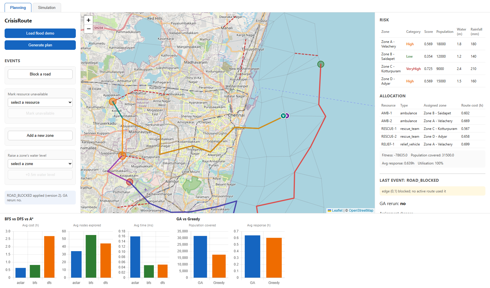
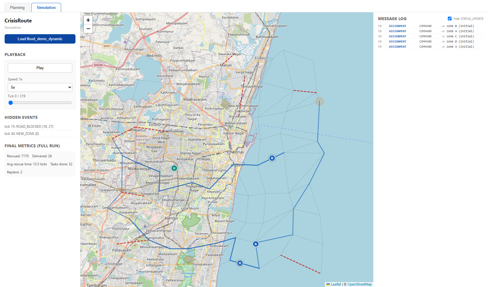
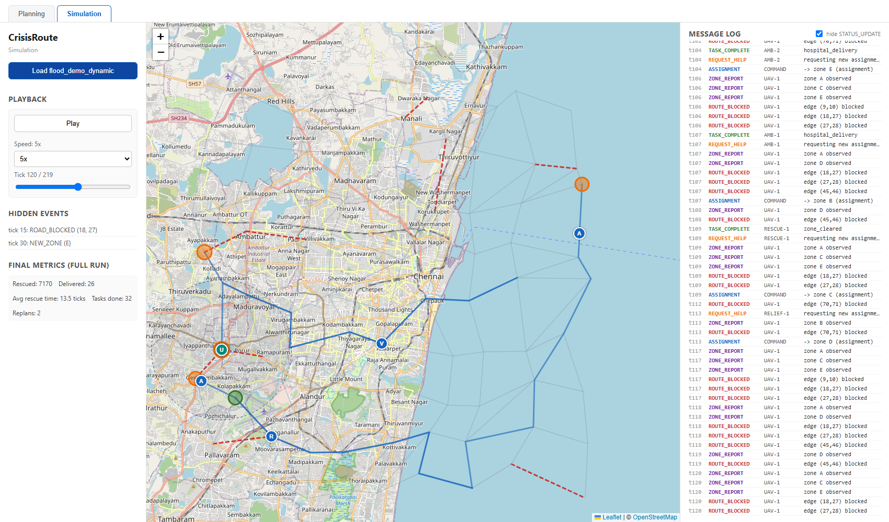

# CrisisRoute

### AI-Based Disaster Response Decision-Support System

**Implementation Report**

| | |
|---|---|
| **Student Name** | _[Your Name]_ |
| **Registration Number** | _[Your Reg. No.]_ |
| **Course** | _[Course Name / Code]_ |
| **Date** | _[Submission Date]_ |
| **GitHub Repository** | [https://github.com/srijanid246/CrisisRoute](https://github.com/srijanid246/CrisisRoute) |

---

## 1. Abstract

CrisisRoute is an AI-based disaster-response decision-support system built around
a synthetic flood scenario in Chennai. Given a road network, a set of hazard
zones, hospitals, and limited emergency resources (ambulances, rescue teams,
relief vehicles), the system assesses each zone's risk with a Bayesian Network,
allocates resources with a hand-written Genetic Algorithm (benchmarked against a
greedy baseline), routes vehicles with hand-written A*, BFS and DFS search, and
replans automatically when conditions change mid-response — a road gets blocked,
a new disaster zone appears, a resource becomes unavailable, or a zone's risk
profile shifts. On top of this planning core sits a discrete-time multi-agent
simulation: five ground/aerial agent types communicate exclusively through a
typed message bus with a command center that holds its own *belief* of the
world, separate from ground truth, so that hidden events are only acted on once
an agent actually discovers and reports them. The whole pipeline is exposed
through a Flask REST API backed by SQLite and visualised in a two-tab React
dashboard (Planning and Simulation), with a Leaflet map, Chart.js comparison
charts, and a live message log. A 30-seed evaluation suite benchmarks every
algorithmic choice made in the project — routing, allocation, and
static-vs-dynamic replanning — against the alternative the project chose not to
use, with every reported number generated directly from the code, not
estimated.

---

## 2. Technology Stack

### Backend

| Component | Technology | Version | Purpose |
|---|---|---|---|
| Language | Python | 3.13.5 | Core implementation language for every backend module |
| Web framework | Flask | 3.1.3 | REST API server |
| CORS | Flask-CORS | 6.0.5 | Allows the React frontend (different origin/port) to call the API |
| ORM / database | SQLAlchemy | 2.1.4 | Portable data-access layer over SQLite (swappable to PostgreSQL without code changes) |
| Database | SQLite | (stdlib, via SQLAlchemy) | Persists scenarios, plan versions, and events |
| Probabilistic graphical models | pgmpy | 1.1.2 | Bayesian Network construction and exact inference (Variable Elimination) for risk assessment |
| Numerical computing | NumPy | 2.5.3 | Supporting numerical operations |
| Plotting | Matplotlib | 3.11.2 | All evaluation charts (PNG output) |
| Testing | pytest | 9.1.1 | Full backend test suite (239 tests) |

### Frontend

| Component | Technology | Version | Purpose |
|---|---|---|---|
| Language | JavaScript (JSX) | ES2020+ | React component implementation |
| UI library | React | 18.3.1 | Component-based dashboard |
| Build tool | Vite | 5.4.2 | Dev server and production bundler |
| Mapping | React-Leaflet / Leaflet | 4.2.1 / 1.9.4 | Interactive map: road network, zones, resources, agent animation |
| Charts | Chart.js / react-chartjs-2 | 4.4.4 / 5.2.0 | Routing and allocation comparison bar charts |
| Package manager | npm | 11.19.0 | Dependency management |
| Runtime | Node.js | 24.20.0 | Frontend build/dev tooling |

### Tooling

| Tool | Purpose |
|---|---|
| Git | Version control |
| PowerShell (`start.ps1`) | One-command launch of both services on Windows |
| Playwright (dev-time only) | Used to drive the running app end-to-end and capture the screenshots in this report |

No cloud services, paid APIs, or external data sources are used — the entire
system runs locally from synthetic, seeded data, by design (see Section 6).

---

## 3. System Architecture

```
 Scenario Generator  ---->  Bayesian Network Risk  ----\
 (road graph, zones,        (pgmpy, VariableElim.)       \
  resources, hospitals)                                   v
                                                   Genetic Algorithm /
                                                   Greedy Allocation
                                                           |
                                                           v
                                                  A* / BFS / DFS Routing
                                                           |
                                                           v
                                                    Dynamic Replanning
                                              (ROAD_BLOCKED, NEW_ZONE,
                                           RESOURCE_UNAVAILABLE, RISK_CHANGE)
                                                           |
                                        +------------------+------------------+
                                        v                                     v
                              Flask REST API                      Multi-Agent Simulation
                              (SQLite persistence)                 (MessageBus, 5 agent
                                        |                           types, partial
                                        v                           observability)
                              React Dashboard                                |
                           (Planning tab, Simulation tab)  <------------------+
```

Every later stage is built *on top of* the earlier ones rather than
duplicating logic: the allocation module calls the routing module to build its
cost matrix; the replanning module calls the Planner (risk → allocation →
routing) and reuses the same event objects the simulation's hidden-event
scheduler applies to the true world; the API layer is a thin (de)serialization
wrapper around the same Python objects used everywhere else; the frontend is a
pure consumer of the API's JSON.

---

## 4. Implementation Details

### 4.1 Synthetic Scenario Generator (`backend/crisisroute/scenario/`)

Generates a fully reproducible crisis scenario from an integer seed: a
jittered-grid road network centred on Chennai (≈80 nodes by default, ≈300 for
the stress-test preset), with haversine-computed edge lengths, randomised
posted speeds, a condition (`good` / `damaged` / `flooded`) and a `blocked`
flag per edge; 4–15 hazard zones (population, vulnerable %, water level,
rainfall, infrastructure condition, road accessibility); two depots; two
hospitals with fixed bed capacity; and a mix of ambulances, rescue teams, and
relief vehicles. Three presets ship with the project: `flood_demo` (a fixed,
hand-tuned 4-zone scenario used throughout the report), `large` (300 nodes / 15
zones / 25 resources, used to stress-test the GA), and `flood_demo_dynamic`
(the `flood_demo` scenario plus two scheduled hidden events, used by the
simulation layer).

### 4.2 Bayesian Network Risk Assessment (`backend/crisisroute/risk/`)

A four-layer discrete Bayesian Network built with `pgmpy`:
`Rainfall, WaterLevel → Hazard`; `PopulationDensity, VulnerablePopulation →
Exposure`; `RoadAccessibility, InfrastructureCondition → Vulnerability`;
`Hazard, Exposure, Vulnerability → Risk` (`Low / Medium / High / VeryHigh`).
Every conditional probability table is defined explicitly in code (no
learned/estimated parameters) via a severity-index lookup so each table is
auditable. Continuous zone attributes are discretised with fixed thresholds.
Inference uses exact Variable Elimination and supports **partial evidence** —
a zone can be assessed even if only some of its attributes are known, which
the simulation layer relies on when a zone's true state isn't yet fully
observed. The output is a full posterior over the four risk categories plus a
single `risk_score ∈ [0, 1]` (the expected value over states), used directly in
the allocation fitness function.

### 4.3 Genetic Algorithm Resource Allocation (`backend/crisisroute/allocation/`)

A hand-written GA (no DEAP or other GA library) allocates every resource to a
zone or leaves it idle. Chromosome: one gene per resource, holding the
assigned zone index or `-1`. Operators: **tournament selection**, **uniform
crossover**, **random-reset mutation**, and **elitism** — all implemented from
scratch, configurable via a `GAConfig` dataclass (population 80, generations
150, crossover rate 0.8, mutation rate 0.05 by default). Fitness function:

```
fitness = Σ_zones (risk_score × population × coverage(n_assigned))
          − λ × total_travel_time
          − penalty × unmet_type_needs
```

`coverage(n) = 1 − 0.5ⁿ` gives diminishing returns per extra resource sent to
the same zone. Each zone's minimum resource-type needs (e.g. a `VeryHigh`-risk
zone needs at least one ambulance and one rescue team) are derived from its
risk category and population. A **greedy baseline** (sort zones by risk, assign
the nearest available resource of the needed type) is implemented alongside
the GA purely as a point of comparison — Section 7 reports exactly how much
better the GA does.

### 4.4 A*, BFS, DFS Routing (`backend/crisisroute/routing/`)

All three search algorithms are implemented by hand (no `networkx` or other
graph library) behind one `search(graph, start, goal, algorithm)` interface
returning the path, cost, nodes explored, and execution time. A*'s heuristic
is the haversine distance to the goal divided by the network's maximum edge
speed — admissible by construction, since no real edge can be traversed faster.
All three algorithms skip `blocked` edges during traversal. A* was verified
optimal against a hand-written brute-force Dijkstra oracle across 50 random
seed/pair combinations in the test suite.

### 4.5 Dynamic Replanning (`backend/crisisroute/replanning/`)

A `Planner` class runs the full risk → allocation → routing pipeline once
(`create_plan`) and then reacts to four event types via `apply_event`:

- **ROAD_BLOCKED** — marks an edge blocked and reroutes only the routes that
  used it; if a reroute becomes unreachable or costs more than 30% more, the
  whole GA is rerun instead of just patching the route.
- **NEW_ZONE** — adds the zone, assesses its risk, and reruns the GA *seeded*
  with the current allocation (a warm start).
- **RESOURCE_UNAVAILABLE** — removes the resource from the allocation pool and
  reruns the GA.
- **RISK_CHANGE** — reassesses a zone's risk and reruns the GA only if its
  risk *category* actually changed.

A separate `static_outcome()` function evaluates what would happen if the
*old* plan were kept unchanged under the new conditions (treating a blocked
route or unavailable resource as a failed delivery) — this is the static
baseline that Section 7 compares dynamic replanning against.

### 4.6 Multi-Agent Simulation (`backend/crisisroute/agents/`)

A discrete-time simulation layer built on top of the Planner. Five agent
types, each an explicit state machine:

- **AmbulanceAgent**: `IDLE → EN_ROUTE → AT_ZONE → TO_HOSPITAL → UNLOADING →
  IDLE`; picks the nearest hospital with free bed capacity.
- **RescueTeamAgent**: travels to its zone and rescues people at a fixed rate
  per tick until the zone is cleared or it is reassigned mid-task.
- **SupplyVehicleAgent**: delivers relief units to its zone, then returns to
  depot to reload.
- **UAVAgent**: flies in a straight line between zones (ignoring the road
  network entirely) and surveys everything within a 5 km radius of its current
  position.
- **CommandCenterAgent**: owns the `Planner` and a *belief* copy of the
  scenario, separate from the simulation's true world state.

All inter-agent coordination goes through a typed `MessageBus` (`ASSIGNMENT`,
`STATUS_UPDATE`, `ROUTE_BLOCKED`, `ZONE_REPORT`, `TASK_COMPLETE`,
`REQUEST_HELP`) — no agent ever reads another agent's internal state directly,
and every message is logged. The simulation supports **partial
observability**: hidden events (e.g. a road blocking at tick 15, a new zone
appearing at tick 30) are applied to the *true* world silently; the command
center's belief only updates once a ground agent physically reaches the
blocked road, or the UAV's survey radius covers it — verified directly in
tests by checking the belief state tick-by-tick before and after discovery.

### 4.7 Flask REST API (`backend/crisisroute/api/`)

Eight endpoints, backed by three SQLAlchemy models (`scenarios`, `plans` —
versioned per scenario, `events`):

| Method | Endpoint | Purpose |
|---|---|---|
| POST | `/api/scenarios` | Generate and store a new scenario (by seed or preset) |
| GET | `/api/scenarios/<id>` | Fetch the scenario's graph, zones, resources |
| POST | `/api/scenarios/<id>/plan` | Create the initial plan |
| POST | `/api/scenarios/<id>/events` | Apply a replanning event; returns the new plan, diff, and static-outcome comparison |
| GET | `/api/scenarios/<id>/plans` | List every plan version for a scenario |
| GET | `/api/scenarios/<id>/compare/routing` | BFS/DFS/A* metrics for the current plan's routes |
| GET | `/api/scenarios/<id>/compare/allocation` | GA vs greedy metrics for the current scenario |
| POST | `/api/scenarios/<id>/simulate` | Run the multi-agent simulation and return per-tick snapshots and final metrics |

### 4.8 React Dashboard (`frontend/`)

A two-tab single-page app:

- **Planning tab** — load a scenario, generate a plan, and trigger events
  (click a road to block it, click the map to add a zone, pick a resource to
  mark unavailable, raise a zone's water level) directly on a Leaflet map
  showing the road network, risk-coloured zones, resource markers, and
  current routes; a right panel shows the risk table, allocation table, and
  (after an event) a diff view with before/after metrics; a bottom row of
  Chart.js bars compares BFS/DFS/A* and GA/greedy.
- **Simulation tab** — loads `flood_demo_dynamic` and plays back the
  multi-agent simulation tick-by-tick with play/pause and speed controls,
  agents animated along interpolated positions (icon per type, colour per
  state), the UAV's survey radius drawn as a circle, hidden events rendered
  greyed-out until actually discovered, a scrollable colour-coded message
  log, and replanned routes highlighted in red.

### 4.9 Evaluation Suite (`eval/`)

`run_eval.py` sweeps 30 seeds across every comparison the project makes a
design decision about — routing algorithms, allocation algorithms (at two
problem scales), and static vs. dynamic replanning (including the
computational cost of replanning itself) — and writes the results to CSV,
renders them to PNG charts, and prints a summary table. `eval/RESULTS.md`
narrates the findings using only the script's actual output (see Section 7).

---

## 5. Configuration and Setup

### Prerequisites

- Python 3.13 (or compatible 3.11+)
- Node.js 20+ and npm
- Windows with PowerShell (for `start.ps1`); the two services can also be
  started manually on any OS

### Backend setup

```bash
cd backend
python -m venv venv
venv\Scripts\pip install -r requirements.txt   # Windows
# source venv/bin/pip install -r requirements.txt   # macOS/Linux
```

`requirements.txt` lists exactly: `flask`, `flask-cors`, `sqlalchemy`,
`pgmpy`, `numpy`, `matplotlib`, `pytest`.

### Frontend setup

```bash
cd frontend
npm install
```

### Running the app

```powershell
# From the repository root, starts both services and waits until they respond:
.\start.ps1
```

This launches the Flask API on `http://localhost:5000` (SQLite file created
at `backend/crisisroute.db`) and the Vite dev server on
`http://localhost:5173`, each in its own window. Manually, the equivalent is
`python run_api.py` in `backend/` and `npm run dev` in `frontend/`.

### Running the tests and evaluation

```bash
cd backend && venv\Scripts\pytest tests -q      # 239 tests
cd eval && python run_eval.py                    # writes results/ and figures/
```

### Project conventions (`DEVELOPMENT.md`)

- No comments in code — code is written to read clearly from naming and
  structure alone.
- The Genetic Algorithm and all search algorithms (A*, BFS, DFS) are
  hand-written; no third-party GA or graph-search library is used for them.
- Everything that involves randomness is seeded and reproducible — the same
  seed always produces the same scenario, allocation, and simulation.
- Every module has a corresponding pytest test module.

---

## 6. Evaluation Results

Full data, charts, and narrative are in
[`eval/RESULTS.md`](../eval/RESULTS.md); the headline numbers (from an actual
30-seed run, not estimated):

**Routing — BFS vs DFS vs A\*** (300 searches/algorithm): A* path cost
averages **0.49 h** vs BFS's 0.63 h and DFS's 2.20 h, while also exploring the
fewest nodes (24.3 vs 42.8 / 41.3) — the heuristic genuinely prunes the
search, at a small wall-clock cost (0.096 ms vs ~0.04–0.05 ms).

**Allocation — GA vs Greedy** (30 seeds, two scales): at the default scale,
GA's fitness was ≥ greedy's in **30/30 seeds**, covering 34% more population
on average (33,254 vs 24,746) with a *lower* response time, *higher*
utilisation, and *lower* travel cost. At a 25-resource/15-zone stress scale,
GA's edge narrows (21/30 seeds, +15% population covered) — an expected effect
of a fixed GA budget against a search space **~4×10²⁶ times larger**; a
dedicated check confirmed the GA does *not* converge prematurely at this
scale (mean plateau generation 94.3, vs 21.3 at the default scale).

**Static vs Dynamic Replanning** (30 seeds × 4 scenario types): dynamic
replanning drove failed deliveries to **exactly 0.00** across every
disruptive event type tested, where the static baseline lost 2.93 deliveries
on average under a road blockage (39% less population covered) and left a
new zone **100% uncovered**. The replanning mechanism itself is cheap when it
can be: a route-only reroute (no GA rerun) costs **0.375 ms** on average vs
**182.1 ms** for a full GA rerun — about **486× faster** — and the system
correctly chooses the cheap path 16 of 30 times a road is blocked.

---

## 7. Screenshots

**Planning tab — plan generated for `flood_demo`.** Risk table (top right),
allocation table with per-resource routes, and the BFS/DFS/A* and GA/Greedy
comparison charts at the bottom.


**Planning tab — after a `ROAD_BLOCKED` event.** The diff panel reports which
edge was blocked, whether a GA rerun was triggered, and the before/after
metrics.



**Simulation tab — tick 0.** All five ground/aerial agents receive their
initial assignment from the command center; the message log shows the five
`ASSIGNMENT (initial)` messages.



**Simulation tab — tick 35, just after the hidden new-zone event is
discovered.** The UAV's survey radius is drawn as a dashed circle; the
replanned routes (to zones E, A, D) are highlighted in red; the message log
shows `ASSIGNMENT ... (replan)`.


**Simulation tab — tick 120, deep into the run.** A richer message history
(`TASK_COMPLETE`, `REQUEST_HELP`, repeated `ASSIGNMENT`s) and agents in a mix
of states (idle, en route, delivering).



---

## 8. GitHub Repository

**[https://github.com/srijanid246/CrisisRoute](https://github.com/srijanid246/CrisisRoute)**

The repository contains the complete implementation described in this
report — backend, frontend, tests, and evaluation suite — and is accessible
for review.

---

## 9. Conclusion

CrisisRoute implements a full disaster-response decision-support pipeline —
risk assessment, resource allocation, routing, and dynamic replanning — each
stage built on hand-written, seeded, and independently tested algorithms
rather than off-the-shelf solvers, and benchmarks every major design decision
(A* vs BFS/DFS, GA vs greedy, dynamic vs static replanning) against real
30-seed experimental data rather than assumption. The multi-agent simulation
layer adds a genuinely partial-observability model of the response, not just
a visualisation, by separating the command center's belief from ground
truth. Natural extensions include integrating real OpenStreetMap data in
place of the synthetic road network, moving persistence to PostgreSQL/PostGIS
for spatial queries at scale, a multi-agent coordination layer that
negotiates directly between agents rather than only through a central command
center, and a feedback-learning loop that adjusts the risk network's
probability tables from observed outcomes over repeated runs.
